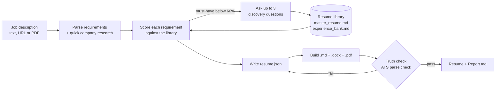

# AI Resume Tailor

[](https://github.com/HrishiPurandare/ai-resume-tailor/actions/workflows/ci.yml)
[](LICENSE)

Paste a job description into [Claude Code](https://docs.anthropic.com/claude-code), and get back a tailored, ATS-friendly resume as Markdown, Word and PDF, plus a report on coverage, gaps and interview prep.

It is built on one rule: **the resume may only contain what is in your own resume library.** An LLM writing a resume will happily invent a metric or a tool, so this repo tests every output for that, the same way you'd test any other system that can hallucinate.

## How it works



1. **Library first.** `resumes/master_resume.md` (your confirmed facts, plus a "Rejected" list of things never to claim) and `resumes/experience_bank.md` (experiences surfaced in past sessions) are the only source of truth.
2. **Fast mode by default.** Claude parses the JD, does 2–3 quick searches about the company, scores each requirement, and only stops to ask you questions when a must-have is weak.
3. **Generate.** Claude writes `resume.json`, and the tools build a single-column, A4, ATS-safe resume.
4. **Guard.** Two automated checks run on every resume (below).
5. **Learn.** Anything new you confirm goes into the experience bank, dated and tagged with the job that surfaced it, so the next resume starts richer.

## The guards

| Check | What it catches | Tool |
|---|---|---|
| **Truth check** | A number, employer, job title, date or named tool that isn't in the library, or anything from the library's "Rejected" list | `tools/truth_check.js` |
| **ATS parse check** | Content an applicant tracking system can't read back out of the DOCX or PDF (bad layout, lost bullets, broken headings), plus optional JD keyword coverage | `tools/ats_check.py`, using [MarkItDown](https://github.com/microsoft/markitdown) as the text extractor |

The test suite includes **negative tests**: it tampers with the example (an invented 95% metric, an unlisted tool, a rejected item, a changed employer, a missing bullet) and asserts that each guard fails.

```
Truth check
  ok    passes for the example
  ok    fails on an invented metric
  ok    fails on a tool that isn't in the library
  ok    fails on an item from the Rejected list
  ok    fails on a changed employer name or dates
ATS parse check (MarkItDown)
  ok    every item is readable from the DOCX and the PDF
  ok    fails when content is missing from the files
```

## Quick start

Requirements: Node.js 20+, Python 3.10–3.14, and [Claude Code](https://docs.anthropic.com/claude-code).

```bash
git clone --recurse-submodules https://github.com/HrishiPurandare/ai-resume-tailor.git
cd ai-resume-tailor
npm install            # docx + Puppeteer (downloads a headless Chrome)
npm run setup:py       # creates .venv with MarkItDown
npm test               # builds the example and runs every check
```

Then create your private library (git-ignored):

```bash
mkdir -p resumes applications
cp examples/jane-doe/master_resume.md resumes/master_resume.md   # replace with your own facts
touch resumes/experience_bank.md application-tracker.md
```

Already have resumes as PDF or Word? Convert them first, then build `master_resume.md` from the text:

```bash
npm run import -- old-resumes/*.pdf old-resumes/*.docx -o resumes/imported
```

Open the folder in Claude Code and paste a job description or URL. `CLAUDE.md` tells Claude the workflow and the rules.

## Plans and free options

**Claude Code needs a paid plan.** It works with Claude Pro, Max, Team or Enterprise, or with an Anthropic Console account (an API key, paid per use). The free claude.ai plan doesn't include Claude Code ([setup docs](https://code.claude.com/docs/en/setup)).

You don't need Claude Code to use this repo. The workflow is plain Markdown (`CLAUDE.md`, `AGENTS.md` and the skill files), and every tool is ordinary Node or Python that never calls an AI. Pick whichever option fits:

| Option | Cost | Web research | Best for |
|---|---|---|---|
| [Claude Code](#quick-start) | Paid plan or API key | Built in | The full automatic workflow |
| [Gemini CLI](#option-1-gemini-cli-free-tier) | Free tier with a Google account | Built in | Closest free equivalent |
| [GitHub Copilot, Cursor, Codex CLI](#option-2-other-coding-agents) | Free tiers with limits, or paid | Varies | If you already use one |
| [Aider with a local model](#option-3-aider-with-a-local-model-fully-free-offline) | Free, runs on your computer | No (paste the JD) | Fully free and private |
| [Free claude.ai chat](#option-4-free-claudeai-or-any-ai-chat) | Free | Yes | No install beyond Node and Python |
| [No AI at all](#option-5-no-ai-at-all) | Free | No | Writing `resume.json` yourself |

Free tiers and limits change often, so check each tool's current terms.

**Whichever option you choose, the checks still apply.** `npm run truth` and `npm run ats` don't depend on the AI, so they catch an invented metric or an unreadable PDF however the resume was written. Smaller or local models are more likely to bend the "never fabricate" rule, so always run both.

### Before any option

Do the [Quick start](#quick-start) steps first (clone, `npm install`, `npm run setup:py`, `npm test`) and create your `resumes/` library.

### Option 1: Gemini CLI (free tier)

1. Install it (needs Node.js):
   ```bash
   npm install -g @google/gemini-cli
   ```
2. Start it from the repo folder, and sign in with your Google account when asked:
   ```bash
   cd ai-resume-tailor && gemini
   ```
   It reads `GEMINI.md` automatically, which points it to `AGENTS.md` and `CLAUDE.md`.
3. Paste a job description or URL, for example:
   ```
   Here's a job description. Tailor my resume following AGENTS.md. <paste the JD>
   ```
4. Answer its questions, then check that it ran `npm run truth` and `npm run ats` and that both passed. If it didn't, ask it to.

### Option 2: Other coding agents

GitHub Copilot (agent mode in VS Code, or Copilot CLI), Cursor and OpenAI Codex CLI all read `AGENTS.md`.

1. Open the `ai-resume-tailor` folder in the tool.
2. Start an agent or chat session, and make sure it can read files and run terminal commands.
3. Say: `Read AGENTS.md and follow it. Here is the job description: <paste the JD>`
4. Approve the commands it wants to run (`npm run build`, `pdf`, `truth`, `ats`), and confirm both checks pass.

If a tool doesn't pick up `AGENTS.md` by itself, attach `AGENTS.md` and `CLAUDE.md` to the chat.

### Option 3: Aider with a local model (fully free, offline)

[Aider](https://aider.chat) is an open-source terminal coding assistant. With [Ollama](https://ollama.com) the model runs on your own computer, so nothing leaves it.

1. Install Ollama from [ollama.com](https://ollama.com), then download a coding model:
   ```bash
   ollama pull qwen2.5-coder
   ```
2. Install Aider:
   ```bash
   python3 -m pip install aider-install && aider-install
   ```
3. Start Aider in the repo, loading the instructions and your library as read-only context:
   ```bash
   aider --model ollama_chat/qwen2.5-coder --read AGENTS.md --read CLAUDE.md --read vendor/resume-tailoring-skill/skills/resume-tailoring/SKILL.md --read resumes/master_resume.md --read resumes/experience_bank.md
   ```
4. Paste the job description, and ask it to write `applications/<Company>_<Role>_<date>/resume.json`.
5. Build and check it yourself (see [Commands](#commands)):
   ```bash
   npm run build -- <folder>/resume.json <folder>/<Name>_Resume && npm run pdf -- <folder>/<Name>_Resume
   ```
   ```bash
   npm run truth -- <folder>/resume.json resumes/master_resume.md resumes/experience_bank.md && npm run ats -- <folder>/resume.json <folder>/<Name>_Resume
   ```
6. If a check fails, paste its output back into Aider and ask it to fix `resume.json`. Local models make more mistakes than large hosted ones, so expect to iterate.

You can also use Aider with a hosted model and your own API key instead of Ollama.

### Option 4: Free claude.ai (or any AI chat)

The free claude.ai plan supports Skills, file creation and code execution, so you can do the writing in a chat and the building on your computer.

1. In a new chat, attach `AGENTS.md`, `CLAUDE.md`, `vendor/resume-tailoring-skill/skills/resume-tailoring/SKILL.md`, your `master_resume.md` and `experience_bank.md`, and `examples/jane-doe/resume.json` as a format example.
2. Paste the job description and ask: `Follow AGENTS.md and write a resume.json in the same format as the example. Use only facts from my master resume and experience bank.`
3. Answer its questions, then save the `resume.json` it gives you into `applications/<Company>_<Role>_<date>/`.
4. Build and check it with the commands from Option 3, step 5.
5. If a check fails, paste the output into the chat and ask for a corrected `resume.json`.

This works the same way with ChatGPT, Gemini or any other chat assistant.

### Option 5: No AI at all

1. Copy the example as a starting point:
   ```bash
   mkdir -p applications/My_Application && cp examples/jane-doe/resume.json applications/My_Application/
   ```
2. Edit `resume.json` by hand with your own content.
3. Build and check it with the commands from Option 3, step 5. You still get an ATS-safe DOCX and PDF, a 2-page check, a truth check against your library, and an ATS parse check.

## Commands

| Command | What it does |
|---|---|
| `npm run build -- <resume.json> <base>` | Writes `<base>.md`, `<base>.docx` and a temporary `<base>.html` |
| `npm run pdf -- <base>` | Prints `<base>.html` to an A4 `<base>.pdf` and deletes the `.html` |
| `npm run truth -- <resume.json> <library.md...> [--allow=Word]` | Truth check against the library |
| `npm run ats -- <resume.json> <base> [--keywords JD.md]` | ATS parse check on the DOCX and PDF |
| `npm run import -- <files or URLs> -o <dir>` | Converts PDF, DOCX, PPTX, XLSX, HTML or a URL to Markdown |
| `npm test` | Full suite, including negative tests |

## Repository layout

```
CLAUDE.md                  workflow and rules Claude follows
AGENTS.md                  the same, for Codex, Copilot, Cursor, Aider and others
GEMINI.md                  pointer for Gemini CLI
.claude/skills/            resume-tailoring skill (symlinks into vendor/)
vendor/resume-tailoring-skill/   upstream skill (git submodule, MIT)
tools/                     build, PDF, truth check, ATS check, import
tests/run.js               test suite
examples/jane-doe/         fictional person: library, JD, resume, report
resumes/ applications/     YOUR data: git-ignored, never committed
```

## Privacy

Your library, applications and tracker hold contact details and job-search notes. They are listed in `.gitignore` and never leave your machine. The only person in this repository is the fictional Jane Doe. MarkItDown is used with its offline converters only: no plugins, no cloud services.

## Credits

- [varunr89/resume-tailoring-skill](https://github.com/varunr89/resume-tailoring-skill) (MIT): the research, matching and discovery-question skill this workflow builds on.
- [microsoft/markitdown](https://github.com/microsoft/markitdown) (MIT): document-to-Markdown conversion, used for importing and for the ATS parse check.
- [docx](https://github.com/dolanmiu/docx) and [Puppeteer](https://github.com/puppeteer/puppeteer): Word and PDF output.

## License

[MIT](LICENSE) © 2026 Hrishikesh Purandare
