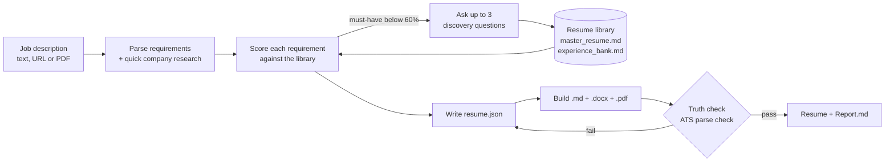

# AI Resume Tailor

[](https://github.com/HrishiPurandare/ai-resume-tailor/actions/workflows/ci.yml)
[](LICENSE)

Paste a job description into [Claude Code](https://docs.anthropic.com/claude-code), and get back a tailored, ATS-friendly resume as Markdown, Word and PDF, plus a report on coverage, gaps and interview prep.

It is built on one rule: **the resume may only contain what is in your own resume library.** An LLM writing a resume will happily invent a metric or a tool, so this repo tests every output for that, the same way you'd test any other system that can hallucinate.

## How it works



1. **Library first.** `resumes/master_resume.md` (your confirmed facts, plus a "Rejected" list of things never to claim) and `resumes/experience_bank.md` (experiences surfaced in past sessions) are the only source of truth.
2. **Fast mode by default.** Claude parses the JD, does 2–3 quick searches about the company, scores each requirement, and only stops to ask you questions when a must-have is weak.
3. **Generate.** Claude writes `resume.json`, and the tools build a single-column, A4, ATS-safe resume.
4. **Guard.** Two automated checks run on every resume (below).
5. **Learn.** Anything new you confirm goes into the experience bank, dated and tagged with the job that surfaced it, so the next resume starts richer.

## The guards

| Check | What it catches | Tool |
|---|---|---|
| **Truth check** | A number, employer, job title, date or named tool that isn't in the library, or anything from the library's "Rejected" list | `tools/truth_check.js` |
| **ATS parse check** | Content an applicant tracking system can't read back out of the DOCX or PDF (bad layout, lost bullets, broken headings), plus optional JD keyword coverage | `tools/ats_check.py`, using [MarkItDown](https://github.com/microsoft/markitdown) as the text extractor |

The test suite includes **negative tests**: it tampers with the example (an invented 95% metric, an unlisted tool, a rejected item, a changed employer, a missing bullet) and asserts that each guard fails.

```
Truth check
  ok    passes for the example
  ok    fails on an invented metric
  ok    fails on a tool that isn't in the library
  ok    fails on an item from the Rejected list
  ok    fails on a changed employer name or dates
ATS parse check (MarkItDown)
  ok    every item is readable from the DOCX and the PDF
  ok    fails when content is missing from the files
```

## Quick start

Requirements: Node.js 20+, Python 3.10–3.14, and [Claude Code](https://docs.anthropic.com/claude-code).

```bash
git clone --recurse-submodules https://github.com/HrishiPurandare/ai-resume-tailor.git
cd ai-resume-tailor
npm install            # docx + Puppeteer (downloads a headless Chrome)
npm run setup:py       # creates .venv with MarkItDown
npm test               # builds the example and runs every check
```

Then create your private library (git-ignored):

```bash
mkdir -p resumes applications
cp examples/jane-doe/master_resume.md resumes/master_resume.md   # replace with your own facts
touch resumes/experience_bank.md application-tracker.md
```

Already have resumes as PDF or Word? Convert them first, then build `master_resume.md` from the text:

```bash
npm run import -- old-resumes/*.pdf old-resumes/*.docx -o resumes/imported
```

Open the folder in Claude Code and paste a job description or URL. `CLAUDE.md` tells Claude the workflow and the rules.

## Commands

| Command | What it does |
|---|---|
| `npm run build -- <resume.json> <base>` | Writes `<base>.md`, `<base>.docx` and a temporary `<base>.html` |
| `npm run pdf -- <base>` | Prints `<base>.html` to an A4 `<base>.pdf` and deletes the `.html` |
| `npm run truth -- <resume.json> <library.md...> [--allow=Word]` | Truth check against the library |
| `npm run ats -- <resume.json> <base> [--keywords JD.md]` | ATS parse check on the DOCX and PDF |
| `npm run import -- <files or URLs> -o <dir>` | Converts PDF, DOCX, PPTX, XLSX, HTML or a URL to Markdown |
| `npm test` | Full suite, including negative tests |

## Repository layout

```
CLAUDE.md                  workflow and rules Claude follows
.claude/skills/            resume-tailoring skill (symlinks into vendor/)
vendor/resume-tailoring-skill/   upstream skill (git submodule, MIT)
tools/                     build, PDF, truth check, ATS check, import
tests/run.js               test suite
examples/jane-doe/         fictional person: library, JD, resume, report
resumes/ applications/     YOUR data: git-ignored, never committed
```

## Privacy

Your library, applications and tracker hold contact details and job-search notes. They are listed in `.gitignore` and never leave your machine. The only person in this repository is the fictional Jane Doe. MarkItDown is used with its offline converters only: no plugins, no cloud services.

## Credits

- [varunr89/resume-tailoring-skill](https://github.com/varunr89/resume-tailoring-skill) (MIT): the research, matching and discovery-question skill this workflow builds on.
- [microsoft/markitdown](https://github.com/microsoft/markitdown) (MIT): document-to-Markdown conversion, used for importing and for the ATS parse check.
- [docx](https://github.com/dolanmiu/docx) and [Puppeteer](https://github.com/puppeteer/puppeteer): Word and PDF output.

## License

[MIT](LICENSE) © 2026 Hrishikesh Purandare
