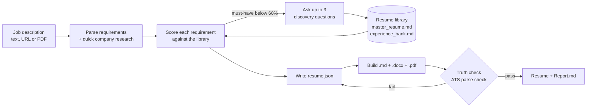

# AI Resume Tailor

[](https://github.com/HrishiPurandare/ai-resume-tailor/actions/workflows/ci.yml)
[](LICENSE)

Paste a job description into [Claude Code](https://docs.anthropic.com/claude-code), and get back a tailored, ATS-friendly resume as Markdown, Word and PDF, plus a report on coverage, gaps and interview prep.

It is built on one rule: **the resume may only contain what is in your own resume library.** An LLM writing a resume will happily invent a metric or a tool, so this repo tests every output for that, the same way you'd test any other system that can hallucinate.

## How it works



1. **Library first.** `resumes/master_resume.md` (your confirmed facts, plus a "Rejected" list of things never to claim) and `resumes/experience_bank.md` (experiences surfaced in past sessions) are the only source of truth.
2. **Fast mode by default.** Claude parses the JD, does 2–3 quick searches about the company, scores each requirement, and only stops to ask you questions when a must-have is weak.
3. **Generate.** Claude writes `resume.json`, and the tools build a single-column, A4, ATS-safe resume.
4. **Guard.** Two automated checks run on every resume (below).
5. **Learn.** Anything new you confirm goes into the experience bank, dated and tagged with the job that surfaced it, so the next resume starts richer.

## The guards

| Check | What it catches | Tool |
|---|---|---|
| **Truth check** | A number, employer, job title, date or named tool that isn't in the library, or anything from the library's "Rejected" list | `tools/truth_check.js` |
| **ATS parse check** | Content an applicant tracking system can't read back out of the DOCX or PDF (bad layout, lost bullets, broken headings), plus optional JD keyword coverage | `tools/ats_check.py`, using [MarkItDown](https://github.com/microsoft/markitdown) as the text extractor |

The test suite includes **negative tests**. It tampers with the example (an invented 95% metric, an unlisted tool, a rejected item, a changed employer, a missing bullet) and asserts that each guard fails. It also checks that confirming a skill makes the check pass, and that a Rejected item can't be added back by any route.

```
Truth check
  ok    passes for the example
  ok    fails on an invented metric
  ok    fails on a tool that isn't in the library
  ok    fails on an item from the Rejected list
  ok    fails on a changed employer name or dates
ATS parse check (MarkItDown)
  ok    every item is readable from the DOCX and the PDF
  ok    fails when content is missing from the files
```

## When the truth check fails: add what you've really done

The truth check is strict on purpose, but it isn't a dead end. A failure usually means one of two things:
- the AI invented something, so fix the resume; or
- the job needs a skill you **do** have that isn't in your library yet, so add it.

You choose how strict to be:

| Mode | Command | What happens |
|---|---|---|
| **Strict** (default) | `npm run truth -- <resume.json> resumes/master_resume.md resumes/experience_bank.md` | Fails on anything unsupported, and tells you how to add it if it's true |
| **Interactive** | same, plus `--interactive --jd="Company Role"` | Asks about each item: true or not? If yes, where and what you did. Saves the answers to your experience bank and re-checks |
| **Add directly** | `npm run add -- --skill="Kubernetes" --where="Acme Ltd" --detail="Deployed test environments"` | Records one skill, tool or certification. Use `--metric="35%"` for a number. With no flags, it asks the questions |
| **Draft** | add `--warn` | Lists the problems but doesn't fail. For early drafts only; fix them before you send the resume |
| **Wording** | add `--allow=Deterministic` | Ignores capitalised words that are ordinary wording, not tool names |

**Example: the JD asks for Kubernetes, and you've used it but never wrote it down.**

```text
$ npm run truth -- applications/Acme/resume.json resumes/master_resume.md resumes/experience_bank.md --interactive --jd="Acme Senior QA"
TRUTH CHECK: 1 unsupported claim(s)
  - skill/tool not in library: Kubernetes

For each item, answer y only if it's TRUE for you. Anything you confirm is saved to the experience bank.

  Is "Kubernetes" true for you?
    [y/N] y
    Where? (employer name, or 'personal project'): Acme Ltd
    What did you do? (one line, optional): Set up test environments with a pod per microservice

Saved 1 confirmed item(s) to resumes/experience_bank.md
TRUTH CHECK PASS: every number, employer, title, date and named skill traces to the library
```

The entry is saved, dated and tagged with the job, so every future resume can use it:

```markdown
## 2026-11-19 — added by user (JD: Acme Senior QA)
- **Kubernetes (Acme Ltd):** Set up test environments with a pod per microservice
```

**Guard rails that stay on in every mode:**
- **Answer "yes" only for things you actually did.** The truth check trusts your experience bank.
- **Employers, job titles and dates must match your master resume exactly.** They can't be added interactively; edit `master_resume.md` if one is wrong there.
- **Rejected items stay rejected.** `npm run add` refuses them, `--interactive` won't offer them, and an entry written by hand in the experience bank won't override them. If something on the Rejected list turns out to be true, remove it from `master_resume.md` deliberately.
- **A skill with no employer** ("personal project" or blank) belongs in the skills or summary lines, not under a job. `CLAUDE.md` tells the AI to follow that rule.

## Quick start

Requirements: Node.js 20+, Python 3.10–3.14, and [Claude Code](https://docs.anthropic.com/claude-code).

```bash
git clone --recurse-submodules https://github.com/HrishiPurandare/ai-resume-tailor.git
cd ai-resume-tailor
npm install            # docx + Puppeteer (downloads a headless Chrome)
npm run setup:py       # creates .venv with MarkItDown (all local formats)
npm run setup:py:extras   # optional: + OCR, MCP server, YouTube, audio, Azure (see "Import anything")
npm test               # builds the example and runs every check
```

Then create your private library (git-ignored):

```bash
mkdir -p resumes applications
cp examples/jane-doe/master_resume.md resumes/master_resume.md   # replace with your own facts
touch resumes/experience_bank.md application-tracker.md
```

Already have resumes as PDF or Word? Convert them first, then build `master_resume.md` from the text:

```bash
npm run import -- old-resumes/*.pdf old-resumes/*.docx -o resumes/imported
```

Open the folder in Claude Code and paste a job description or URL. `CLAUDE.md` tells Claude the workflow and the rules.

## Import anything (MarkItDown)

`npm run import` wraps Microsoft's [MarkItDown](https://github.com/microsoft/markitdown) and exposes everything it can do. Use it to turn an old resume library, a job description or any supporting document into Markdown the AI can read.

| Input | Install | Stays on your computer? |
|---|---|---|
| PDF, Word (DOCX), PowerPoint (PPTX), Excel (XLSX, XLS), Outlook (MSG) | `setup:py` | Yes |
| HTML, TXT, Markdown, CSV, JSON, XML, EPUB, ZIP, Jupyter, RSS | `setup:py` | Yes |
| Web pages (job postings) | `setup:py` | Fetches the page you name |
| Images (JPG, PNG...) | `setup:py` | Yes (metadata only; text needs `--ocr`) |
| Scanned PDFs, text inside images (`--ocr`) | `setup:py:extras` | **Yes with a local model** (Ollama, LM Studio); otherwise sent to your LLM provider |
| AI image descriptions (`--describe-images`) | `setup:py:extras` | Same as above |
| YouTube videos (transcript of an interview tip or company talk) | `setup:py:extras` | Fetches the transcript you name |
| Audio (MP3, WAV, M4A) | `setup:py:extras` | **No**: uses an online speech service, so needs `--allow-cloud` |
| Azure Document Intelligence / Content Understanding | `setup:py:extras` + Azure account | **No**: needs `--allow-cloud` |

Run `npm run import -- --list-formats` to see what's installed.

**Examples:**

```bash
# A whole folder of old resumes (subfolders too), keeping the folder structure
npm run import -- old-resumes --recursive -o resumes/imported

# A job description from a web page, a PDF, or a slide deck
npm run import -- "https://example.com/careers/senior-qa" -o applications/Acme_QA_2026-11-20
npm run import -- jd.pdf skills-matrix.xlsx team-overview.pptx -o applications/Acme_QA_2026-11-20

# A scanned resume, read by a vision model running locally with Ollama (nothing leaves your machine)
ollama pull llava
npm run import -- scanned_resume.pdf --ocr --llm-base-url http://localhost:11434/v1 --llm-model llava

# The same with OpenAI (sends the pages to OpenAI, so it needs --allow-cloud)
OPENAI_API_KEY=sk-... npm run import -- scanned_resume.pdf --ocr --allow-cloud

# Print to the terminal, or pipe a file in
npm run import -- jd.docx --stdout
cat jd.pdf | npm run import -- - --stdin-ext .pdf --stdout
```

Other options: `--force` to overwrite, `--llm-prompt` for a custom OCR prompt, `--plugins` for third-party MarkItDown plugins, `--keep-data-uris` to keep embedded images, and `--docintel-endpoint` / `--cu-endpoint` for Azure. `npm run import -- --help` lists them all.

Converted files are reference material. Confirm the facts before they go into `master_resume.md`.

### Let the AI convert files itself (MCP server)

With the extras installed, the repo's `.mcp.json` registers MarkItDown's MCP server. Claude Code asks you to approve it the first time you open the folder, and after that the agent can call `convert_to_markdown` on any file, web page or `data:` URI by itself. For example: "read the JD in ~/Downloads/jd.pdf".

Other MCP-capable tools (Cursor, Cline, Gemini CLI, Claude Desktop) can use the same server: point them at `bash tools/markitdown_mcp.sh`. The server runs locally over stdio and can read whatever files your user account can, so only use it with agents you trust.

## Plans and free options

**Claude Code needs a paid plan.** It works with Claude Pro, Max, Team or Enterprise, or with an Anthropic Console account (an API key, paid per use). The free claude.ai plan doesn't include Claude Code ([setup docs](https://code.claude.com/docs/en/setup)).

You don't need Claude Code to use this repo. The workflow is plain Markdown (`CLAUDE.md`, `AGENTS.md` and the skill files), and every tool is ordinary Node or Python that never calls an AI. Pick whichever option fits:

| Option | Cost | Web research | Best for |
|---|---|---|---|
| [Claude Code](#quick-start) | Paid plan or API key | Built in | The full automatic workflow |
| [Gemini CLI](#option-1-gemini-cli-free-tier) | Free tier with a Google account | Built in | Closest free equivalent |
| [GitHub Copilot, Cursor, Codex CLI](#option-2-other-coding-agents) | Free tiers with limits, or paid | Varies | If you already use one |
| [Aider with a local model](#option-3-aider-with-a-local-model-fully-free-offline) | Free, runs on your computer | No (paste the JD) | Fully free and private |
| [Free claude.ai chat](#option-4-free-claudeai-or-any-ai-chat) | Free | Yes | No install beyond Node and Python |
| [No AI at all](#option-5-no-ai-at-all) | Free | No | Writing `resume.json` yourself |

Free tiers and limits change often, so check each tool's current terms.

**Whichever option you choose, the checks still apply.** `npm run truth` and `npm run ats` don't depend on the AI, so they catch an invented metric or an unreadable PDF however the resume was written. Smaller or local models are more likely to bend the "never fabricate" rule, so always run both.

### Before any option

Do the [Quick start](#quick-start) steps first (clone, `npm install`, `npm run setup:py`, `npm test`) and create your `resumes/` library.

### Option 1: Gemini CLI (free tier)

1. Install it (needs Node.js):
   ```bash
   npm install -g @google/gemini-cli
   ```
2. Start it from the repo folder, and sign in with your Google account when asked:
   ```bash
   cd ai-resume-tailor && gemini
   ```
   It reads `GEMINI.md` automatically, which points it to `AGENTS.md` and `CLAUDE.md`.
3. Paste a job description or URL, for example:
   ```
   Here's a job description. Tailor my resume following AGENTS.md. <paste the JD>
   ```
4. Answer its questions, then check that it ran `npm run truth` and `npm run ats` and that both passed. If it didn't, ask it to.

### Option 2: Other coding agents

GitHub Copilot (agent mode in VS Code, or Copilot CLI), Cursor and OpenAI Codex CLI all read `AGENTS.md`.

1. Open the `ai-resume-tailor` folder in the tool.
2. Start an agent or chat session, and make sure it can read files and run terminal commands.
3. Say: `Read AGENTS.md and follow it. Here is the job description: <paste the JD>`
4. Approve the commands it wants to run (`npm run build`, `pdf`, `truth`, `ats`), and confirm both checks pass.

If a tool doesn't pick up `AGENTS.md` by itself, attach `AGENTS.md` and `CLAUDE.md` to the chat.

### Option 3: Aider with a local model (fully free, offline)

[Aider](https://aider.chat) is an open-source terminal coding assistant. With [Ollama](https://ollama.com) the model runs on your own computer, so nothing leaves it.

1. Install Ollama from [ollama.com](https://ollama.com), then download a coding model:
   ```bash
   ollama pull qwen2.5-coder
   ```
2. Install Aider:
   ```bash
   python3 -m pip install aider-install && aider-install
   ```
3. Start Aider in the repo, loading the instructions and your library as read-only context:
   ```bash
   aider --model ollama_chat/qwen2.5-coder --read AGENTS.md --read CLAUDE.md --read vendor/resume-tailoring-skill/skills/resume-tailoring/SKILL.md --read resumes/master_resume.md --read resumes/experience_bank.md
   ```
4. Paste the job description, and ask it to write `applications/<Company>_<Role>_<date>/resume.json`.
5. Build and check it yourself (see [Commands](#commands)):
   ```bash
   npm run build -- <folder>/resume.json <folder>/<Name>_Resume && npm run pdf -- <folder>/<Name>_Resume
   ```
   ```bash
   npm run truth -- <folder>/resume.json resumes/master_resume.md resumes/experience_bank.md && npm run ats -- <folder>/resume.json <folder>/<Name>_Resume
   ```
6. If a check fails, paste its output back into Aider and ask it to fix `resume.json`. Local models make more mistakes than large hosted ones, so expect to iterate. If the check flags a skill you really have, add it with `--interactive` or `npm run add` (see [When the truth check fails](#when-the-truth-check-fails-add-what-youve-really-done)).

You can also use Aider with a hosted model and your own API key instead of Ollama.

### Option 4: Free claude.ai (or any AI chat)

The free claude.ai plan supports Skills, file creation and code execution, so you can do the writing in a chat and the building on your computer.

1. In a new chat, attach `AGENTS.md`, `CLAUDE.md`, `vendor/resume-tailoring-skill/skills/resume-tailoring/SKILL.md`, your `master_resume.md` and `experience_bank.md`, and `examples/jane-doe/resume.json` as a format example.
2. Paste the job description and ask: `Follow AGENTS.md and write a resume.json in the same format as the example. Use only facts from my master resume and experience bank.`
3. Answer its questions, then save the `resume.json` it gives you into `applications/<Company>_<Role>_<date>/`.
4. Build and check it with the commands from Option 3, step 5.
5. If a check fails, paste the output into the chat and ask for a corrected `resume.json`.

This works the same way with ChatGPT, Gemini or any other chat assistant.

### Option 5: No AI at all

1. Copy the example as a starting point:
   ```bash
   mkdir -p applications/My_Application && cp examples/jane-doe/resume.json applications/My_Application/
   ```
2. Edit `resume.json` by hand with your own content.
3. Build and check it with the commands from Option 3, step 5. You still get an ATS-safe DOCX and PDF, a 2-page check, a truth check against your library, and an ATS parse check.

## Commands

| Command | What it does |
|---|---|
| `npm run build -- <resume.json> <base>` | Writes `<base>.md`, `<base>.docx` and a temporary `<base>.html` |
| `npm run pdf -- <base>` | Prints `<base>.html` to an A4 `<base>.pdf` and deletes the `.html` |
| `npm run truth -- <resume.json> <library.md...> [--interactive] [--warn] [--allow=Word]` | Truth check against the library (see [modes](#when-the-truth-check-fails-add-what-youve-really-done)) |
| `npm run add -- --skill=X --where=Employer --detail="..."` | Records a skill, tool, certification or `--metric` in your experience bank |
| `npm run ats -- <resume.json> <base> [--keywords JD.md]` | ATS parse check on the DOCX and PDF |
| `npm run import -- <files, folders, URLs or -> [-o dir] [--recursive] [--stdout] [--ocr] ...` | Converts almost any document to Markdown (see [Import anything](#import-anything-markitdown)) |
| `npm run setup:py` / `npm run setup:py:extras` | Python tools: local formats only / everything (OCR, MCP, YouTube, audio, Azure) |
| `npm test` | Full suite, including negative tests |

## Repository layout

```
CLAUDE.md                  workflow and rules Claude follows
AGENTS.md                  the same, for Codex, Copilot, Cursor, Aider and others
GEMINI.md                  pointer for Gemini CLI
.claude/skills/            resume-tailoring skill (symlinks into vendor/)
vendor/resume-tailoring-skill/   upstream skill (git submodule, MIT)
tools/                     build, PDF, truth check, ATS check, import, add experience, MCP launcher
.mcp.json                  registers the MarkItDown MCP server for Claude Code
tests/                     test suite, fixture generator, MCP smoke test
examples/jane-doe/         fictional person: library, JD, resume, report
resumes/ applications/     YOUR data: git-ignored, never committed
```

## Privacy

Your library, applications and tracker hold contact details and job-search notes. They are listed in `.gitignore` and never leave your machine. The only person in this repository is the fictional Jane Doe.

**Local by default.** The ATS check and normal imports use MarkItDown's offline converters. Anything that would send a file to an outside service (OCR or image descriptions with a hosted model, audio transcription, Azure) is refused unless you add `--allow-cloud`. OCR with a local model (`--llm-base-url http://localhost:...`) stays on your machine and needs no flag. Third-party plugins stay off unless you pass `--plugins`.

## Credits

- [varunr89/resume-tailoring-skill](https://github.com/varunr89/resume-tailoring-skill) (MIT): the research, matching and discovery-question skill this workflow builds on.
- [microsoft/markitdown](https://github.com/microsoft/markitdown) (MIT), with `markitdown-ocr` and `markitdown-mcp`: document-to-Markdown conversion, OCR and the MCP server, used for importing and for the ATS parse check.
- [docx](https://github.com/dolanmiu/docx) and [Puppeteer](https://github.com/puppeteer/puppeteer): Word and PDF output.

## License

[MIT](LICENSE) © 2026 Hrishikesh Purandare
